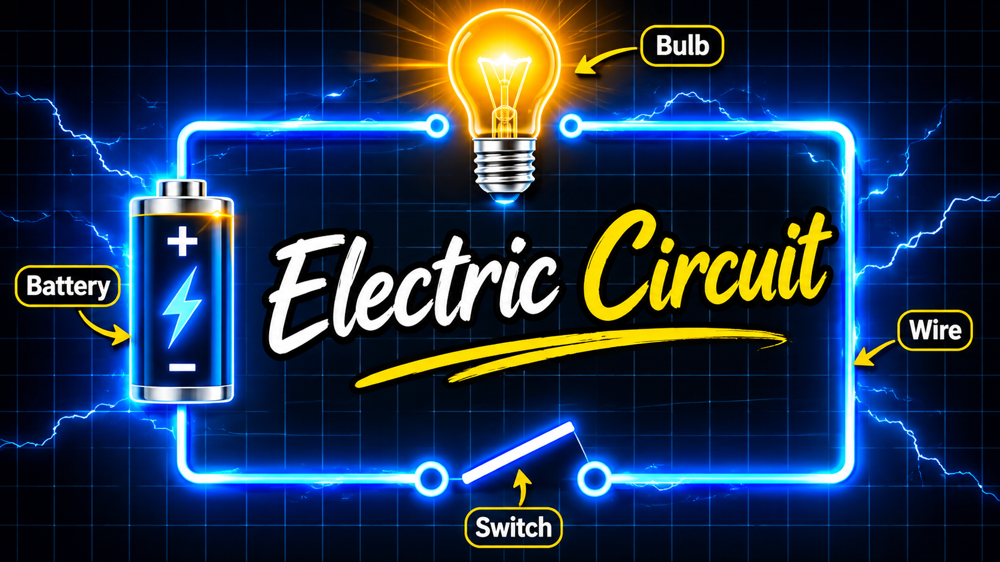
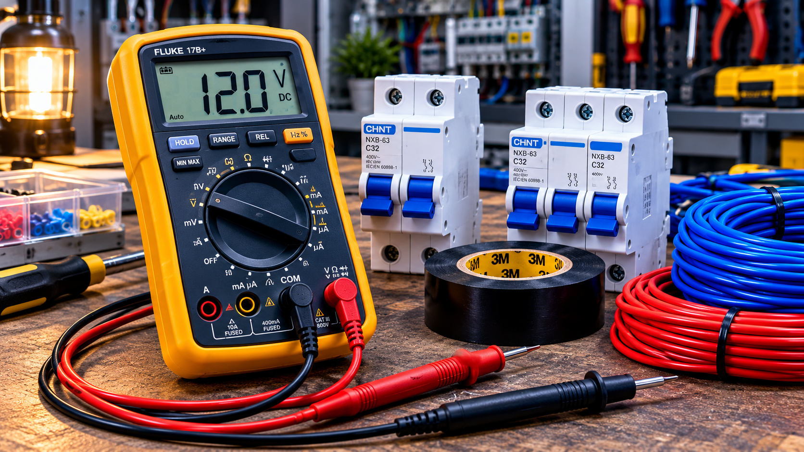
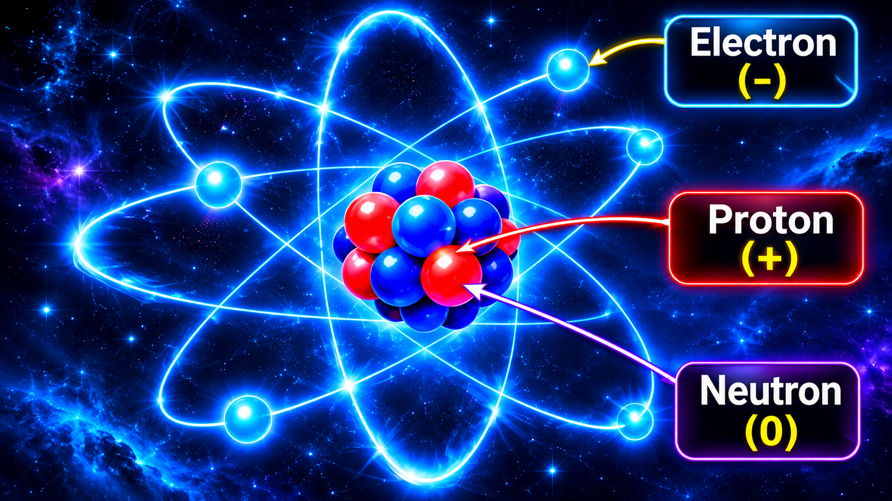
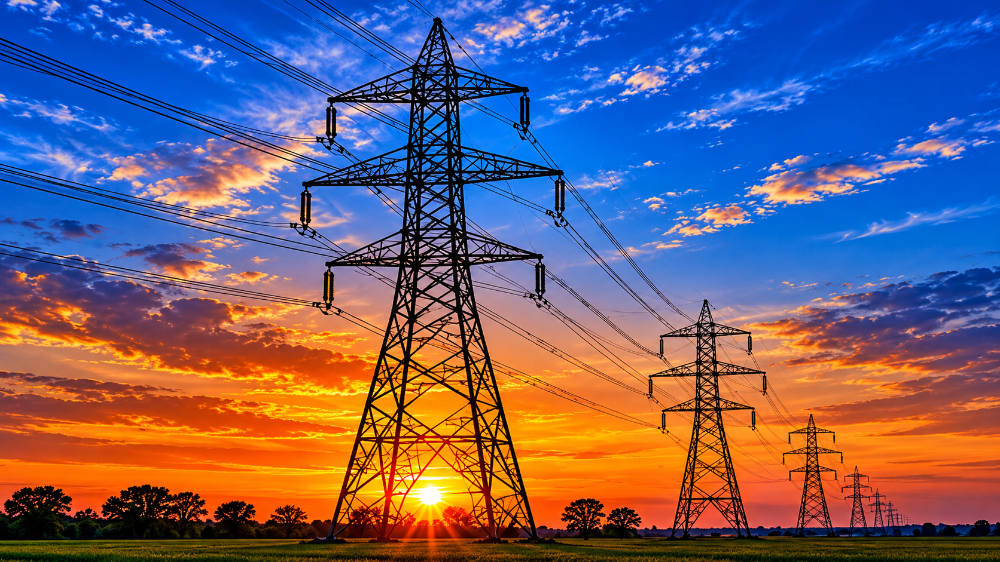
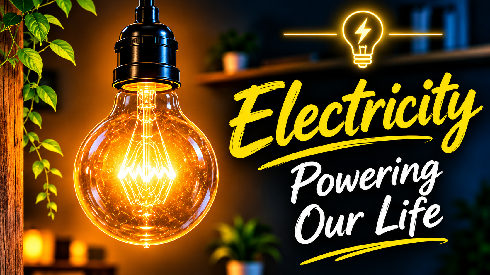
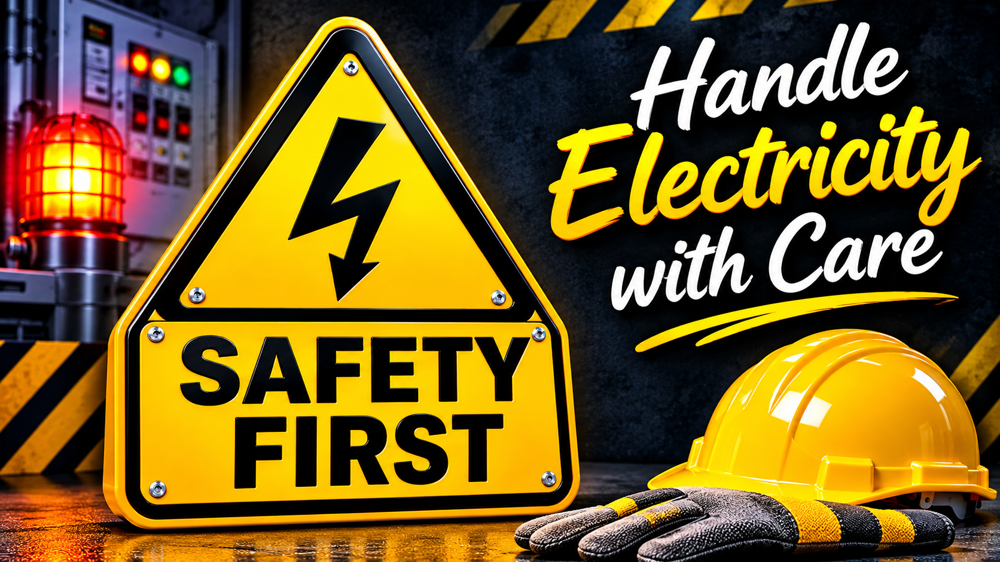

বিদ্যুতের জগতে প্রথম পরিচয় | Introduction to Electricity

আমাদের প্রতিদিনের জীবনে বিদ্যুৎ বা Electricity অত্যন্ত গুরুত্বপূর্ণ একটি বিষয়। সকালে ঘুম থেকে ওঠার পর লাইট জ্বালানো, ফ্যান চালানো, মোবাইল চার্জ দেওয়া, ফ্রিজ ব্যবহার করা কিংবা কম্পিউটারে কাজ করা—প্রায় প্রতিটি ক্ষেত্রেই আমরা বিদ্যুতের ওপর নির্ভরশীল।

কিন্তু কখনো কি ভেবে দেখেছেন, এই বিদ্যুৎ আসলে কী? কীভাবে এটি তৈরি হয়? কীভাবে একটি ছোট তারের মাধ্যমে বিদ্যুৎ এক জায়গা থেকে অন্য জায়গায় পৌঁছে যায়?

আজ আমরা একদম শূন্য থেকে জানব Electricity কী এবং এটি কীভাবে কাজ করে।

***

#### ১. Electricity ?

Electricity (ইলেক্ট্রিসিটি) হলো পদার্থের মধ্যে থাকা বৈদ্যুতিক চার্জের (Electric Charge) উপস্থিতি এবং চলাচলের সঙ্গে সম্পর্কিত একটি প্রাকৃতিক ঘটনা।

সহজ ভাষায়, কোনো পদার্থের মধ্যে বৈদ্যুতিক চার্জের কারণে যে বৈদ্যুতিক ঘটনা তৈরি হয়, সেটাই Electricity।

আমাদের দৈনন্দিন জীবনে আমরা সাধারণত বিদ্যুৎ বলতে সেই শক্তিকে বুঝি, যা দিয়ে লাইট, ফ্যান, টিভি, মোবাইল ও অন্যান্য বৈদ্যুতিক যন্ত্র চালানো হয়।

উদাহরণ:

- সুইচ অন করলে লাইট জ্বলে।
- ফ্যান চালু করলে মোটর ঘুরতে শুরু করে।
- মোবাইল চার্জারে লাগালে ব্যাটারি চার্জ হয়।
- ফ্রিজ বিদ্যুতের সাহায্যে খাবার ঠান্ডা রাখে।

এই সবকিছুর পেছনেই রয়েছে Electricity।

#### ২. বিদ্যুৎ কোথা থেকে আসে?

বিদ্যুৎ বুঝতে হলে প্রথমে আমাদের জানতে হবে পদার্থ কী দিয়ে তৈরি।

আমাদের চারপাশের সবকিছু—যেমন পানি, বাতাস, লোহা, তামা এবং মানুষের শরীর—অসংখ্য ক্ষুদ্র কণা দিয়ে তৈরি।

এই কণাগুলোর মধ্যে রয়েছে Atom বা পরমাণু।

একটি পরমাণুর প্রধান তিনটি কণা হলো:

১. Electron (ইলেকট্রন)

- এর বৈদ্যুতিক চার্জ Negative বা ঋণাত্মক।
- এটি পরমাণুর নিউক্লিয়াসের বাইরে থাকে।
- ধাতব তারের মধ্যে Electric Current সাধারণত ইলেকট্রনের চলাচলের মাধ্যমে তৈরি হয়।

২. Proton (প্রোটন)

- এর বৈদ্যুতিক চার্জ Positive বা ধনাত্মক।
- এটি পরমাণুর কেন্দ্র বা নিউক্লিয়াসে থাকে।

৩. Neutron (নিউট্রন)

- এর কোনো বৈদ্যুতিক চার্জ নেই।
- এটিও পরমাণুর নিউক্লিয়াসে থাকে।

অর্থাৎ, Electron এবং Proton-এর বৈদ্যুতিক চার্জ রয়েছে। এই চার্জের উপস্থিতি ও চলাচল থেকেই বিভিন্ন বৈদ্যুতিক ঘটনা ঘটে।

#### ৩. বিদ্যুৎ কীভাবে চলাচল করে?

এবার একটি সহজ উদাহরণ দেওয়া যাক।

ধরো, তোমার কাছে একটি ব্যাটারি, একটি বাল্ব, কিছু তার এবং একটি সুইচ আছে।

এগুলো সঠিকভাবে সংযুক্ত করলে একটি Electric Circuit বা বৈদ্যুতিক সার্কিট তৈরি হবে।

যখন সার্কিটটি সম্পূর্ণ থাকবে এবং সুইচ অন করবে, তখন বৈদ্যুতিক চার্জ চলাচল করতে পারবে। ফলে বাল্বটি জ্বলে উঠবে।

কিন্তু সুইচ অফ করলে সার্কিট ভেঙে যাবে এবং বিদ্যুতের চলাচল বন্ধ হবে।

এখানে মনে রাখতে হবে:

- Battery = বিদ্যুতের উৎস।
- Wire = বিদ্যুৎ চলাচলের পথ।
- Switch = বিদ্যুৎ চালু ও বন্ধ করার ব্যবস্থা।
- Bulb = বিদ্যুৎ ব্যবহার করে আলো তৈরি করে।

এই সম্পূর্ণ ব্যবস্থাকেই বলা হয় Electric Circuit।

৪. বিদ্যুতের তিনটি গুরুত্বপূর্ণ বিষয়

Electricity ভালোভাবে বুঝতে হলে তিনটি বিষয় জানা অত্যন্ত জরুরি।

A. Voltage (ভোল্টেজ)

Voltage হলো দুটি বিন্দুর মধ্যে বৈদ্যুতিক বিভবের পার্থক্য (Potential Difference)।

সহজভাবে পানির পাইপের উদাহরণ দেওয়া যায়।

পানির ট্যাংকে যত বেশি চাপ থাকবে, পানি তত বেশি প্রবাহিত হওয়ার সুযোগ পাবে। একইভাবে ভোল্টেজ হলো বৈদ্যুতিক সার্কিটে চার্জ চলাচলের জন্য প্রয়োজনীয় বিভব পার্থক্য।

এর একক হলো Volt (V)।

B. Current (কারেন্ট)

Electric Current হলো কোনো পরিবাহীর মধ্য দিয়ে বৈদ্যুতিক চার্জ প্রবাহিত হওয়ার হার।

সহজ ভাষায়, একটি তারের মধ্য দিয়ে কত পরিমাণ বৈদ্যুতিক চার্জ প্রবাহিত হচ্ছে, সেটাই Current।

এর একক হলো Ampere (A)।

C. Resistance (রেজিস্ট্যান্স)

Resistance হলো বৈদ্যুতিক কারেন্ট প্রবাহে বাধা দেওয়ার ধর্ম।

সহজভাবে পানির পাইপের উদাহরণ দিই।

পাইপ যত সরু হবে, পানির প্রবাহ তত বাধাগ্রস্ত হতে পারে। একইভাবে কোনো পরিবাহীর রেজিস্ট্যান্স বেশি হলে একই ভোল্টেজে কারেন্ট কম প্রবাহিত হয়।

এর একক হলো Ohm (Ω)।

এই তিনটি বিষয় বিদ্যুতের মূল ভিত্তি।

#### ৫. Electricity কত প্রকার?

সাধারণভাবে আমরা বিদ্যুৎকে দুই ভাগে ভাগ করতে পারি।

১. Static Electricity (স্থির বিদ্যুৎ)

যখন কোনো বস্তুর পৃষ্ঠে বৈদ্যুতিক চার্জ জমা হয়ে থাকে, তখন তাকে Static Electricity বলে।

উদাহরণ:

শুকনো চুলে একটি বেলুন ঘষে দেয়ালে ধরলে অনেক সময় বেলুনটি দেয়ালে আটকে যায়।

এটি Static Electricity-এর একটি সহজ উদাহরণ।

২. Current Electricity (প্রবাহ বিদ্যুৎ)

যখন বৈদ্যুতিক চার্জ কোনো পরিবাহীর মধ্য দিয়ে প্রবাহিত হয়, তখন তাকে Current Electricity বলে।

উদাহরণ:

- ঘরের লাইট।
- বৈদ্যুতিক ফ্যান।
- মোবাইল চার্জার।
- পানির মোটর।

আমরা দৈনন্দিন জীবনে সবচেয়ে বেশি Current Electricity ব্যবহার করি।

#### ৬. বিদ্যুৎ কীভাবে তৈরি হয়?

বিদ্যুৎ বিভিন্ন উপায়ে উৎপাদন করা যায়।

কিছু গুরুত্বপূর্ণ উৎস হলো:

১. Power Plant: বিভিন্ন ধরনের বিদ্যুৎকেন্দ্রে জেনারেটরের সাহায্যে বিদ্যুৎ উৎপাদন করা হয়।

২. Solar Panel: সূর্যের আলোকে সরাসরি বৈদ্যুতিক শক্তিতে রূপান্তর করে।

৩. Battery: রাসায়নিক শক্তিকে বৈদ্যুতিক শক্তিতে রূপান্তর করে।

৪. Wind Turbine: বাতাসের শক্তি ব্যবহার করে টারবাইন ঘোরানো হয় এবং জেনারেটরের মাধ্যমে বিদ্যুৎ উৎপাদন করা হয়।

অর্থাৎ, বিদ্যুৎ শুধু একটি উৎস থেকে আসে না। বিভিন্ন শক্তিকে রূপান্তর করে আমরা Electricity তৈরি করতে পারি।

#### ৭. আমাদের জীবনে বিদ্যুতের গুরুত্ব

বর্তমান পৃথিবীতে বিদ্যুৎ ছাড়া আধুনিক জীবন কল্পনা করা কঠিন।

বিদ্যুতের ব্যবহার রয়েছে:

- বাসাবাড়ির আলো ও ফ্যান চালাতে।
- কলকারখানার মেশিন পরিচালনায়।
- হাসপাতালের বিভিন্ন যন্ত্র চালাতে।
- কম্পিউটার ও ইন্টারনেট ব্যবস্থায়।
- পানি তোলা ও সরবরাহের কাজে।
- যোগাযোগ ও পরিবহন ব্যবস্থায়।

এমনকি একজন Electrician-এর কাজেও Electricity সম্পর্কে পরিষ্কার ধারণা থাকা অত্যন্ত গুরুত্বপূর্ণ।

#### ৮. বিদ্যুৎ ব্যবহারে সতর্কতা

বিদ্যুৎ আমাদের উপকার করে, কিন্তু অসতর্ক হলে এটি মারাত্মক বিপদের কারণ হতে পারে।

কিছু গুরুত্বপূর্ণ সতর্কতা:

১. কখনো খালি হাতে Live Wire স্পর্শ করবে না।

২. ভেজা হাতে বৈদ্যুতিক সুইচ বা যন্ত্র স্পর্শ করবে না।

৩. কোনো বৈদ্যুতিক কাজ করার আগে বিদ্যুতের Supply বন্ধ করতে হবে।

৪. সঠিক রেটিংয়ের MCB, Fuse এবং অন্যান্য Protection Device ব্যবহার করতে হবে।

৫. বিদ্যুতের কাজ করার সময় প্রয়োজনীয় Safety Equipment ব্যবহার করতে হবে।

মনে রাখবে, বিদ্যুতের কাজ শেখার প্রথম শর্ত হলো Safety First।

***

আজকের পাঠ থেকে আমরা কী শিখলাম?

আজ আমরা জানলাম:

- Electricity কী।
- Atom বা পরমাণু কী।
- Electron, Proton এবং Neutron কী।
- Electric Circuit কীভাবে কাজ করে।
- Voltage, Current এবং Resistance কী।
- Static Electricity ও Current Electricity কী।
- বিদ্যুৎ কীভাবে উৎপাদন করা হয়।
- বিদ্যুৎ ব্যবহারে কী কী সতর্কতা প্রয়োজন।

শেষ কথা

বিদ্যুৎ শেখা মানে শুধু লাইট, ফ্যান বা মোটর চালানো শেখা নয়। এর পেছনের বৈজ্ঞানিক নিয়মগুলো বোঝাও অত্যন্ত গুরুত্বপূর্ণ।

একজন দক্ষ Electrician হতে হলে শুধু কাজ জানলেই হবে না, কাজের পেছনের কারণও বুঝতে হবে।

তাই আমরা এই সিরিজে একদম Basic থেকে ধাপে ধাপে Electricity শিখব।

Learn Today, Become Better Tomorrow. ⚡

পরবর্তী পাঠ: Electron কী এবং কীভাবে এটি বিদ্যুৎ প্রবাহে ভূমিকা রাখে?
