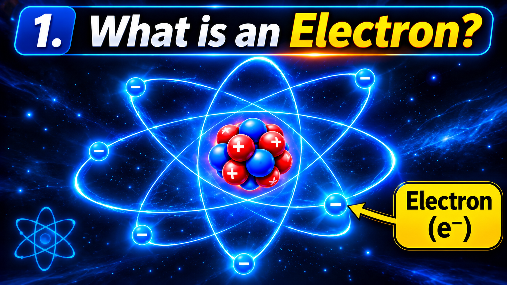
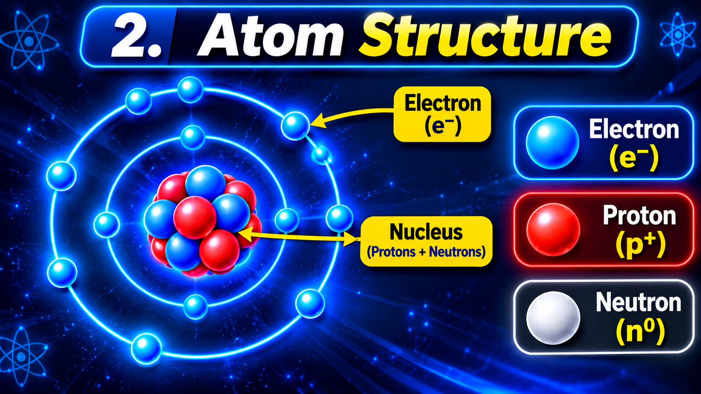
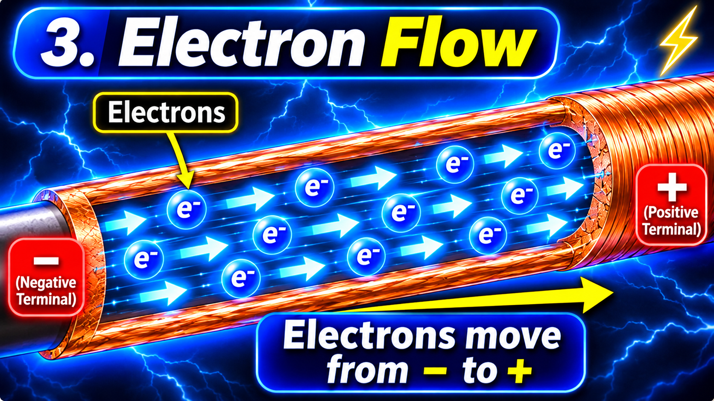
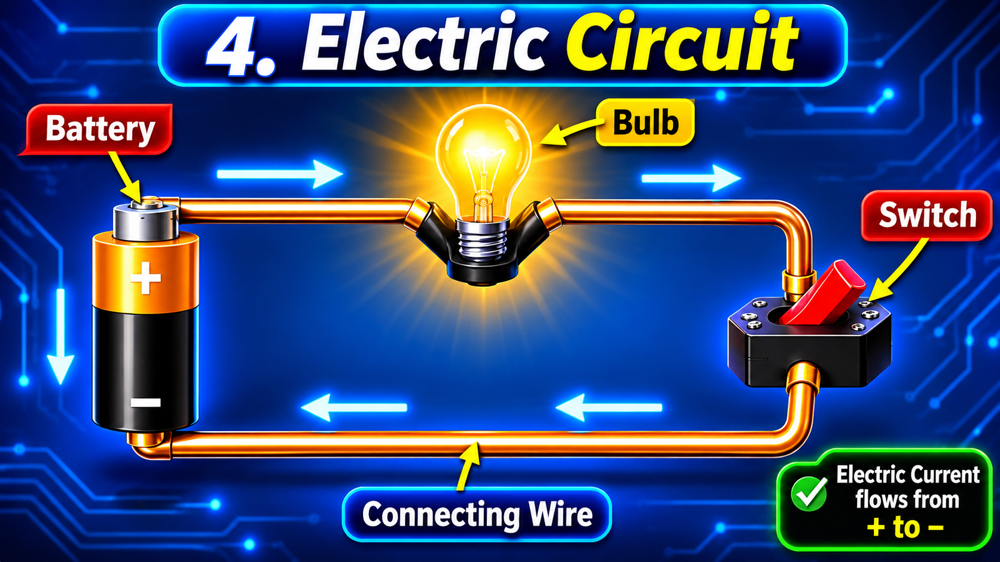
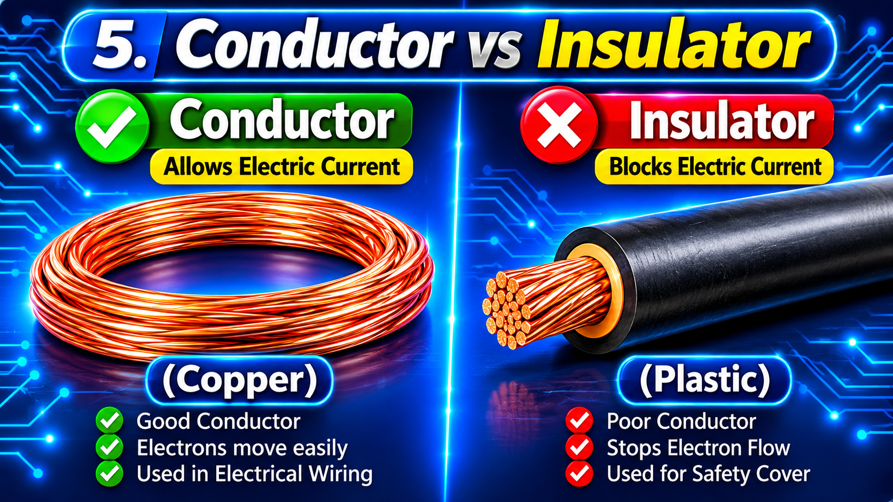
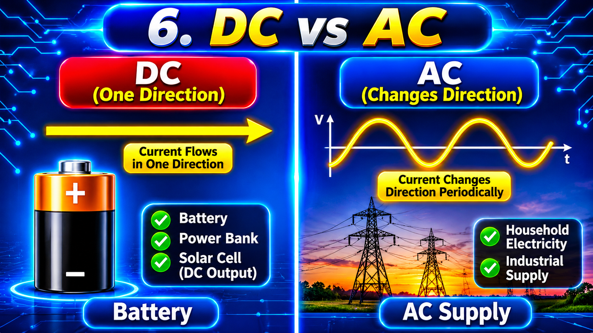
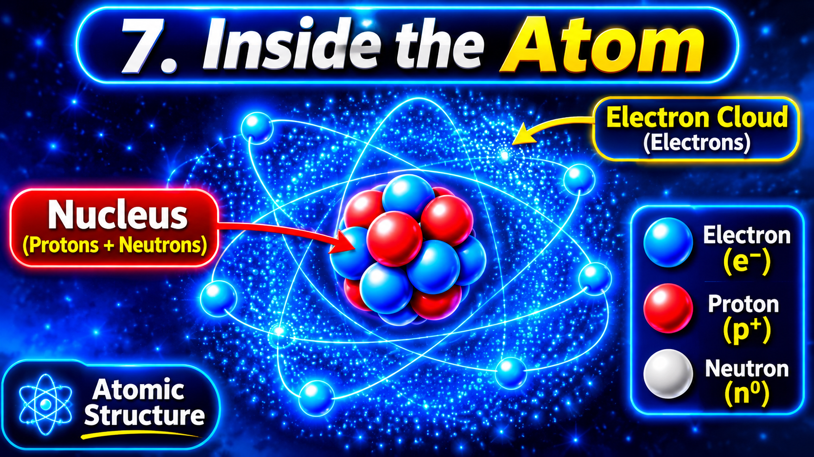
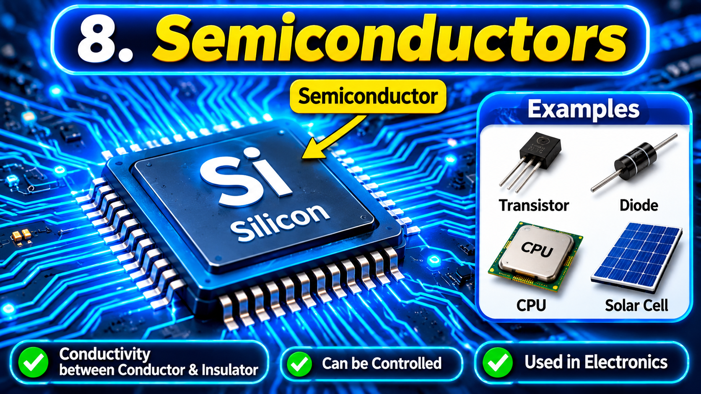
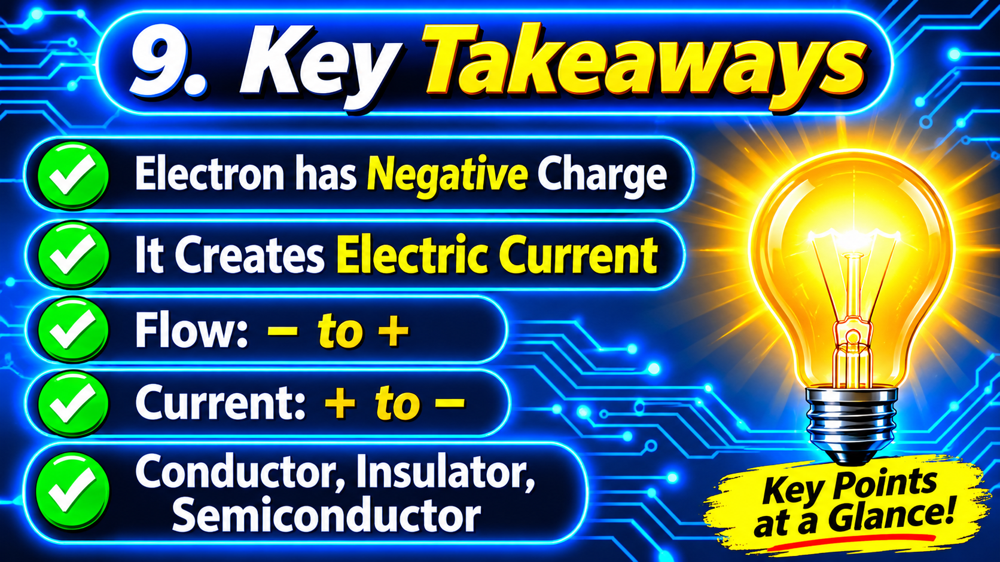

বিদ্যুৎ প্রবাহ তৈরিতে ইলেকট্রনের ভূমিকা | Understanding the Electron

আমরা জানি, আমাদের চারপাশের সব পদার্থ অসংখ্য ক্ষুদ্র কণা দিয়ে তৈরি। এই ক্ষুদ্র কণাগুলোর মধ্যে অন্যতম গুরুত্বপূর্ণ একটি হলো Electron বা ইলেকট্রন।

বিদ্যুৎ কীভাবে কাজ করে, কীভাবে একটি তারের মধ্য দিয়ে কারেন্ট প্রবাহিত হয় এবং কীভাবে একটি বৈদ্যুতিক যন্ত্র চালু হয়—এসব বুঝতে হলে প্রথমে ইলেকট্রন সম্পর্কে পরিষ্কার ধারণা থাকা প্রয়োজন।

আজ আমরা জানব Electron কী, এটি কোথায় থাকে এবং কীভাবে বিদ্যুৎ প্রবাহে ভূমিকা রাখে।

***

#### ১. Electron বা ইলেকট্রন কী?

Electron হলো পরমাণুর (Atom) একটি মৌলিক উপ-পারমাণবিক কণা (Subatomic Particle)।

এর প্রধান বৈশিষ্ট্য হলো, এটি Negative বা ঋণাত্মক বৈদ্যুতিক চার্জ বহন করে।

সহজ ভাষায়, ইলেকট্রন হলো এমন একটি ক্ষুদ্র কণা, যার বৈদ্যুতিক চার্জ ঋণাত্মক এবং যা পরমাণুর গঠনের একটি গুরুত্বপূর্ণ অংশ।

ইলেকট্রনের কিছু বৈশিষ্ট্য:

- নাম: Electron
- প্রতীক: e⁻
- চার্জ: Negative (−)
- অবস্থান: পরমাণুর নিউক্লিয়াসের বাইরের অঞ্চলে
- চার্জের পরিমাণ: প্রায় −1.602 × 10⁻¹⁹ Coulomb

ইলেকট্রনের চার্জের মান খুব ছোট হলেও বৈদ্যুতিক জগতে এর ভূমিকা অত্যন্ত গুরুত্বপূর্ণ।

#### ২. পরমাণুর মধ্যে ইলেকট্রন কোথায় থাকে?

আগের আর্টিকেলে আমরা জেনেছি, একটি পরমাণুর প্রধান তিনটি কণা হলো:

১. Electron (ইলেকট্রন)

২. Proton (প্রোটন)

৩. Neutron (নিউট্রন)

Proton এবং Neutron পরমাণুর কেন্দ্র বা Nucleus-এ থাকে।

অন্যদিকে Electron থাকে নিউক্লিয়াসের বাইরের অঞ্চলে, যাকে Electron Cloud বলা হয়।

ইলেকট্রনকে অনেক সময় সহজভাবে নিউক্লিয়াসের চারপাশে ঘুরতে থাকা কণা হিসেবে দেখানো হয়। তবে এটি বোঝানোর জন্য তৈরি একটি সরল মডেল; বাস্তবে ইলেকট্রনের অবস্থান ও আচরণ আরও জটিল।

#### ৩. ইলেকট্রনের চার্জ কেন Negative?

প্রকৃতিতে বৈদ্যুতিক চার্জ প্রধানত দুই ধরনের:

- Positive Charge (+)
- Negative Charge (−)

Electron-এর চার্জ Negative এবং Proton-এর চার্জ Positive।

একই ধরনের চার্জ একে অপরকে বিকর্ষণ করে, আর বিপরীত ধরনের চার্জ একে অপরকে আকর্ষণ করে।

উদাহরণ:

- Positive ও Positive = বিকর্ষণ।
- Negative ও Negative = বিকর্ষণ।
- Positive ও Negative = আকর্ষণ।

এই আকর্ষণ ও বিকর্ষণ বৈদ্যুতিক জগতের অন্যতম মৌলিক নিয়ম।

#### ৪. ইলেকট্রন কীভাবে বিদ্যুৎ প্রবাহ তৈরি করে?

এবার আসি সবচেয়ে গুরুত্বপূর্ণ বিষয়ে।

ধরো, তোমার কাছে একটি Copper Wire বা তামার তার আছে।

তামা একটি ভালো পরিবাহী (Good Conductor)। এর মধ্যে কিছু ইলেকট্রন তুলনামূলকভাবে সহজে চলাচল করতে পারে। এদের Conduction Electrons বলা হয়।

যখন একটি ব্যাটারি বা Voltage Source দিয়ে সার্কিটে বিভব পার্থক্য তৈরি করা হয়, তখন তারের মধ্যে Electric Field তৈরি হয়।

এই Electric Field-এর প্রভাবে ইলেকট্রনগুলো একটি নির্দিষ্ট দিকে ধীরে ধীরে সরে যেতে শুরু করে।

ধাতব তারের মধ্যে ইলেকট্রনের এই সুশৃঙ্খল প্রবাহই Electric Current বা কারেন্ট তৈরি করে।

সহজ উদাহরণ:

একটি ব্যাটারি, দুটি তার, একটি সুইচ এবং একটি বাল্ব দিয়ে সার্কিট তৈরি করো।

- সুইচ বন্ধ থাকলে সার্কিট সম্পূর্ণ হয়।
- ব্যাটারির Voltage সার্কিটে Electric Field তৈরি করে।
- তারের মধ্যে ইলেকট্রনের Drift বা গড় চলাচল শুরু হয়।
- বাল্বে বৈদ্যুতিক শক্তি পৌঁছে আলো তৈরি হয়।

এভাবেই ইলেকট্রনের চলাচল বিদ্যুৎ প্রবাহের সঙ্গে সম্পর্কিত।

#### ৫. ইলেকট্রন কোন দিকে চলে?

এটি একজন Electrician-এর জন্য খুবই গুরুত্বপূর্ণ বিষয়।

একটি DC Circuit-এ বাহ্যিক সার্কিটের মধ্যে ইলেকট্রন সাধারণত:

Negative (−) Terminal থেকে Positive (+) Terminal-এর দিকে চলে।

কিন্তু Conventional Current বা প্রচলিত কারেন্টের দিক ধরা হয়:

Positive (+) Terminal থেকে Negative (−) Terminal-এর দিকে।

অর্থাৎ, ইলেকট্রনের প্রবাহ এবং প্রচলিত কারেন্টের দিক পরস্পরের বিপরীত।

মনে রাখবে:

Electron Flow: − থেকে +

Conventional Current: + থেকে −

এই বিষয়টি সার্কিট ডায়াগ্রাম ও ইলেকট্রিক্যাল কাজ বোঝার জন্য গুরুত্বপূর্ণ।

#### ৬. সব পদার্থে কি ইলেকট্রন চলাচল করতে পারে?

না। সব পদার্থে ইলেকট্রন একইভাবে চলাচল করতে পারে না।

পদার্থের বৈদ্যুতিক বৈশিষ্ট্য অনুযায়ী আমরা কয়েকটি ভাগ দেখতে পাই।

১. Conductor (পরিবাহী)

যেসব পদার্থের মধ্যে বৈদ্যুতিক চার্জ সহজে চলাচল করতে পারে, সেগুলোকে Conductor বলে।

উদাহরণ:

- Copper (তামা)
- Aluminium (অ্যালুমিনিয়াম)
- Silver (রুপা)

এ কারণেই বৈদ্যুতিক তার তৈরিতে সাধারণত Copper ও Aluminium ব্যবহার করা হয়।

২. Insulator (অপরিবাহী)

যেসব পদার্থের মধ্যে সাধারণ অবস্থায় বৈদ্যুতিক চার্জ সহজে চলাচল করতে পারে না, সেগুলোকে Insulator বলে।

উদাহরণ:

- Rubber (রাবার)
- Plastic (প্লাস্টিক)
- Glass (কাচ)

বৈদ্যুতিক তারের বাইরের আবরণে সাধারণত Insulating Material ব্যবহার করা হয়।

৩. Semiconductor (অর্ধপরিবাহী)

যেসব পদার্থের বৈদ্যুতিক পরিবাহিতা Conductor ও Insulator-এর মাঝামাঝি এবং নিয়ন্ত্রণ করা যায়, সেগুলোকে Semiconductor বলে।

উদাহরণ:

- Silicon (সিলিকন)
- Germanium (জার্মেনিয়াম)

মোবাইল, কম্পিউটার, ট্রানজিস্টর ও বিভিন্ন ইলেকট্রনিক সার্কিটে Semiconductor ব্যবহার করা হয়।

#### ৭. AC ও DC বিদ্যুতে ইলেকট্রনের চলাচল

বিদ্যুৎ প্রধানত দুটি পরিচিত পদ্ধতিতে সরবরাহ করা হয়।

DC (Direct Current):

DC-তে কারেন্টের দিক একদিকে থাকে।

উদাহরণ:

- Battery
- Power Bank
- Solar Cell-এর DC Output

AC (Alternating Current):

AC-তে কারেন্টের দিক নির্দিষ্ট সময় পরপর পরিবর্তিত হয়।

উদাহরণ:

- বাসাবাড়ির বিদ্যুৎ সরবরাহ।
- বিভিন্ন শিল্পকারখানার AC Supply।

AC সার্কিটে ইলেকট্রন সাধারণত একদিকে ক্রমাগত চলে যেতে থাকে না; বরং বৈদ্যুতিক ক্ষেত্রের পরিবর্তনের সঙ্গে সামনে-পেছনে দোলন করে।

#### ৮. একটি গুরুত্বপূর্ণ ভুল ধারণা

অনেকে মনে করে, বাল্ব জ্বালানোর সময় ইলেকট্রন বাল্বের মধ্যে গিয়ে শেষ হয়ে যায়।

আসলে বিষয়টি এমন নয়।

একটি সম্পূর্ণ সার্কিটে চার্জ প্রবাহিত হয় এবং বৈদ্যুতিক শক্তি বিভিন্ন যন্ত্রে স্থানান্তরিত হয়।

বাল্ব সেই শক্তি ব্যবহার করে আলো ও তাপ তৈরি করে। ইলেকট্রন সাধারণত বাল্বে গিয়ে শেষ হয়ে যায় না।

এটি মনে রাখা খুবই গুরুত্বপূর্ণ।

#### ৯. আজকের পাঠের সারাংশ

আজ আমরা শিখলাম:

- Electron কী।
- ইলেকট্রনের চার্জ Negative।
- পরমাণুর মধ্যে ইলেকট্রনের অবস্থান।
- Electric Current তৈরিতে ইলেকট্রনের ভূমিকা।
- Electron Flow ও Conventional Current-এর পার্থক্য।
- Conductor, Insulator ও Semiconductor কী।
- AC ও DC-তে ইলেকট্রনের চলাচল।

#### ১০. নিজের জ্ঞান যাচাই করো (Knowledge Test)

নিচের প্রশ্নগুলোর উত্তর নিজে দেওয়ার চেষ্টা করো।

১. Electron-এর বৈদ্যুতিক চার্জ কী?
২. পরমাণুর কোন অঞ্চলে Electron থাকে?
৩. Copper কেন ভালো Conductor?
৪. DC সার্কিটে ইলেকট্রন কোন দিক থেকে কোন দিকে প্রবাহিত হয়?
৫. Conventional Current-এর দিক কোনটি?
৬. Rubber কেন Insulator হিসেবে ব্যবহার করা হয়?

শেষ কথা

একজন দক্ষ Electrician হতে হলে শুধু তার সংযোগ দেওয়া বা সুইচ লাগানো জানলেই হবে না। বিদ্যুতের ভেতরের বৈজ্ঞানিক বিষয়গুলোও বুঝতে হবে।

কারণ, যে ব্যক্তি কাজের পাশাপাশি কাজের কারণ বুঝতে পারে, সে-ই ধীরে ধীরে একজন দক্ষ Technician হয়ে উঠতে পারে।

Learn Today, Become Better Tomorrow. ⚡

পরবর্তী পাঠ: Proton ও Neutron কী? পরমাণুর গঠনে তাদের ভূমিকা কী?
